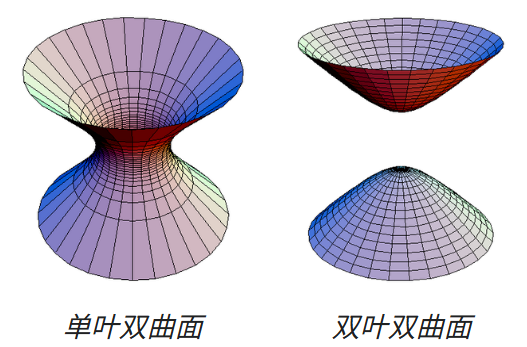
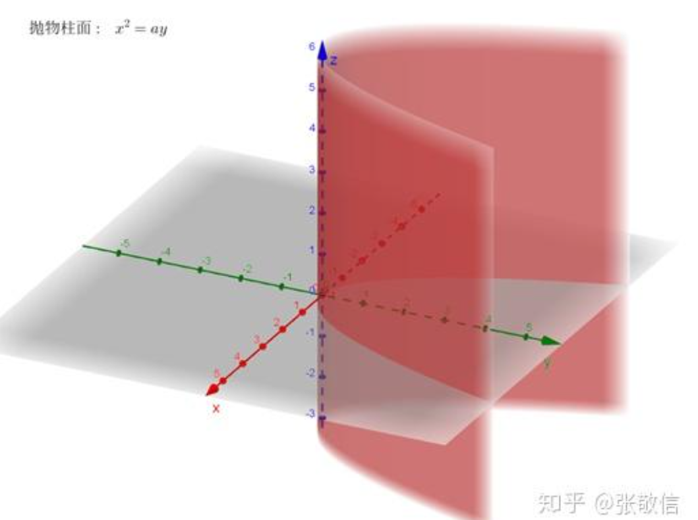

你好！收到你的第二周（Lecture 3 & 4）复习请求。这次的内容主要围绕**空间直线与平面、二次曲面（Quadric Surfaces）以及空间曲线**展开，是向量分析在几何中的核心应用。

我已经完全移除了所有干扰阅读的系统引用注脚，为你生成了一份纯净、排版清晰的复习讲义，你可以直接一键复制。对于比较抽象的曲面和曲线，我帮你加入了对应的图像辅助理解。

---

# 微积分 2M 期末复习讲义 (Lecture 3 & 4)

## 一、 空间直线与平面 (Lines and Planes in 3D)

### 1. 直线方程的三种形式
已知直线上一点 $M_0(x_0, y_0, z_0)$ 和非零方向向量 $\vec{a} = (l, m, n)$：
* **参数方程 (Parametric form)**：
    $x = x_0 + \alpha l$
    $y = y_0 + \alpha m$
    $z = z_0 + \alpha n$  （其中 $\alpha \in \mathbb{R}$ 为参数）
* **标准/对称方程 (Canonical form)**：
    $\frac{x-x_0}{l} = \frac{y-y_0}{m} = \frac{z-z_0}{n}$
    *(注：若某分母为0，则对应分子为0。例如 $l=0$，则 $x=x_0$，直线平行于 $yz$ 平面)*
* **两平面交线 (Intersection of two planes)**：
    $A_1x + B_1y + C_1z + D_1 = 0$
    $A_2x + B_2y + C_2z + D_2 = 0$
    方向向量可以通过两平面法向量的叉积求得：$\vec{a} = \vec{N}_1 \times \vec{N}_2$。

### 2. 位置关系判定
* **两直线的夹角**：定义为它们方向向量 $\vec{a}_1, \vec{a}_2$ 的夹角：$\cos\alpha = \frac{|\vec{a}_1 \cdot \vec{a}_2|}{|\vec{a}_1||\vec{a}_2|}$。
* **两直线共面 (相交)**：两条直线 $L_1(M_1, \vec{a}_1)$ 和 $L_2(M_2, \vec{a}_2)$ 共面的充要条件是向量 $\vec{M_1M_2}, \vec{a}_1, \vec{a}_2$ 的混合积为0，即：$\vec{M_1M_2} \cdot (\vec{a}_1 \times \vec{a}_2) = 0$。
* **直线与平面的关系**：设直线方向为 $\vec{a}$，平面法向量为 $\vec{N}$。
    * **平行**：$\vec{a} \perp \vec{N} \implies \vec{a} \cdot \vec{N} = 0$。
    * **垂直**：$\vec{a} \parallel \vec{N} \implies \vec{a} = \alpha\vec{N}$。
    * **夹角**：直线与平面的夹角 $\theta$ 满足 $\sin\theta = \frac{|\vec{a} \cdot \vec{N}|}{|\vec{a}||\vec{N}|}$。

---

## 二、 核心距离公式与定理证明

> **定理 1：点到平面的距离公式**
> **内容**：点 $M(x_0, y_0, z_0)$ 到平面 $Ax+By+Cz+D=0$ 的距离 $d = \frac{|Ax_0+By_0+Cz_0+D|}{\sqrt{A^2+B^2+C^2}}$。
> **完整证明**：
> 1. 设平面上任意一点为 $M_1(x_1, y_1, z_1)$，则平面法向量为 $\vec{N} = (A, B, C)$。
> 2. 构造从平面上一点指向目标点的向量：$\vec{w} = \vec{M_1M} = (x_0-x_1, y_0-y_1, z_0-z_1)$。
> 3. 距离 $d$ 实际上是向量 $\vec{w}$ 在法向量 $\vec{N}$ 上的投影长度：$d = |\vec{w} \cdot \hat{N}| = \frac{|\vec{w} \cdot \vec{N}|}{|\vec{N}|}$。
> 4. 计算点积：$\vec{w} \cdot \vec{N} = A(x_0-x_1) + B(y_0-y_1) + C(z_0-z_1) = (Ax_0+By_0+Cz_0) - (Ax_1+By_1+Cz_1)$。
> 5. 因为 $M_1$ 在平面上，所以 $Ax_1+By_1+Cz_1 = -D$。代入即得 $d = \frac{|Ax_0+By_0+Cz_0+D|}{\sqrt{A^2+B^2+C^2}}$。得证。

> **定理 2：两异面直线 (Skew lines) 的距离**
> **内容**：设两异面直线过点 $M_1, M_2$，方向向量分别为 $\vec{a}_1, \vec{a}_2$，则它们之间的最短距离 $d = \frac{|\vec{M_1M_2} \cdot (\vec{a}_1 \times \vec{a}_2)|}{|\vec{a}_1 \times \vec{a}_2|}$。
> **完整证明**：
> 1. 两异面直线的公垂线方向向量为 $\vec{N} = \vec{a}_1 \times \vec{a}_2$。
> 2. 距离 $d$ 即为连接两直线上任意两点的向量 $\vec{M_1M_2}$ 在公垂线方向 $\vec{N}$ 上的投影长度。
> 3. 单位公垂向量 $\hat{N} = \frac{\vec{a}_1 \times \vec{a}_2}{|\vec{a}_1 \times \vec{a}_2|}$。
> 4. $d = |\vec{M_1M_2} \cdot \hat{N}| = \frac{|\vec{M_1M_2} \cdot (\vec{a}_1 \times \vec{a}_2)|}{|\vec{a}_1 \times \vec{a}_2|}$。得证。

---

## 三、 二次曲面 (Quadric Surfaces)

空间中的曲面通常由方程 $F(x,y,z)=0$ 描述。二次曲面是最高次为2的方程所表示的曲面，可以通过令 $x=0, y=0, z=0$（截痕法 / Sections）来判断其形状。

* **球面 (Sphere)**：$(x-a)^2 + (y-b)^2 + (z-c)^2 = R^2$
* **椭球面 (Ellipsoid)**：$\frac{x^2}{a^2} + \frac{y^2}{b^2} + \frac{z^2}{c^2} = 1$
* **单叶双曲面 (Hyperboloid of one sheet)**：$\frac{x^2}{a^2} + \frac{y^2}{b^2} - \frac{z^2}{c^2} = 1$
* **双叶双曲面 (Hyperboloid of two sheets)**：$\frac{x^2}{a^2} + \frac{y^2}{b^2} - \frac{z^2}{c^2} = -1$ （注：只有当 $z^2 \ge c^2$ 时才有解，因此分为上下两叶）
* 
* **椭圆锥面 (Elliptic cone)**：$z^2 = \frac{x^2}{a^2} + \frac{y^2}{b^2}$ * **椭圆抛物面 (Elliptic paraboloid)**：$z = \frac{x^2}{a^2} + \frac{y^2}{b^2}$ （水平截面是椭圆，垂直截面是抛物线）* **双曲抛物面/马鞍面 (Hyperbolic paraboloid/Saddle)**：$z = \frac{y^2}{b^2} - \frac{x^2}{a^2}$ * **柱面 (Cylinders)**：方程中缺失某一个变量。如 $\frac{x^2}{a^2} + \frac{y^2}{b^2} = 1$ 是沿 $z$ 轴无限延伸的椭圆柱面；$y = \frac{x^2}{a^2}$ 是抛物柱面。
* 

---

## 四、 空间曲线与参数化 (Curves in 2D and 3D)

曲线通常使用参数方程表示：$\gamma(t) = (x(t), y(t), z(t))$。

### 1. 不同参数化与运动轨迹
同样的几何轨迹，可以有不同的参数化方式（代表不同的运动速度或方向）。
* 例：$\gamma_1(t) = (\cos t, \sin t)$ 且 $t \in [0, \pi/2]$ （逆时针四分之一圆）。
* 例：$\gamma_2(t) = (\sin t, \cos t)$ 且 $t \in [0, \pi/2]$ （也是在第一象限的四分之一圆，但起点变成了 $(0,1)$ 且顺时针运动）。

### 2. 摆线 (Cycloid) 与 星形线 (Astroid)
* **摆线 (Cycloid)**：一个半径为 $R$ 的圆在直线上无滑动滚动，圆周上一点的轨迹。    * 推导思路：圆心位置 $O(t) = (v t, R)$。由于无滑动，滚过的距离 $v t = R\alpha$（$\alpha$为滚动角度）。
    * 点 $P$ 相对于圆心的偏移量为 $(-R\sin\alpha, -R\cos\alpha)$。
    * 最终方程：$x(\alpha) = R(\alpha - \sin\alpha)$，$y(\alpha) = R(1 - \cos\alpha)$。
* **内摆线 (Hypocycloid) / 星形线**：小圆在大圆内部滚动。当大圆半径 $R = 4r$ 时，形成的轨迹是星形线 (Astroid)，其方程可化简为：$\gamma(t) = (R\cos^3 t, R\sin^3 t)$。

---

## 五、 重点例题详细解析

**【例题 1：两平面的交线转化为参数方程】(来源 Lecture 3)**
**题目**：已知两平面方程为 $x-y+3z-3=0$ 和 $3x+2y-z+2=0$，求其交线的参数方程。
**解析**：
1. **求直线上一点**：令 $z=0$，解方程组 $\begin{cases} x-y=3 \\ 3x+2y=-2 \end{cases}$。
   解得 $x = 4/5$, $y = -11/5$。于是得到直线上的点 $M_0(4/5, -11/5, 0)$。
2. **求方向向量 $\vec{a}$**：
   两平面法向量 $\vec{N}_1 = (1, -1, 3)$，$\vec{N}_2 = (3, 2, -1)$。
   $\vec{a} = \vec{N}_1 \times \vec{N}_2 = \begin{vmatrix} \hat{i} & \hat{j} & \hat{k} \\ 1 & -1 & 3 \\ 3 & 2 & -1 \end{vmatrix} = (-5, 10, 5)$。
   为了方便，可以将方向向量按比例缩小（除以5），取 $\vec{a} = (-1, 2, 1)$。
3. **写出参数方程**：
   $x = 4/5 - \alpha$
   $y = -11/5 + 2\alpha$
   $z = \alpha$

**【例题 2：求异面直线的距离】(来源 Lecture 4)**
**题目**：求直线 $L_1: (1+t, 2-2t, 3+t)$ 和直线 $L_2: (3+s, 2-s, s)$ 之间的距离。
**解析**：
1. 提取点与方向向量：
   $M_1 = (1, 2, 3)$，$\vec{a}_1 = (1, -2, 1)$。
   $M_2 = (3, 2, 0)$，$\vec{a}_2 = (1, -1, 1)$。
2. 构造连接两直线的向量：$\vec{M_1M_2} = (3-1, 2-2, 0-3) = (2, 0, -3)$。
3. 计算公垂线法向量 $\vec{N} = \vec{a}_1 \times \vec{a}_2$：
   $\vec{N} = \begin{vmatrix} \hat{i} & \hat{j} & \hat{k} \\ 1 & -2 & 1 \\ 1 & -1 & 1 \end{vmatrix} = (-1, 0, 1)$。
4. 计算距离 $d$ (利用定理2的公式)：
   $d = \frac{|\vec{M_1M_2} \cdot \vec{N}|}{|\vec{N}|} = \frac{|(2)(-1) + (0)(0) + (-3)(1)|}{\sqrt{(-1)^2 + 0^2 + 1^2}} = \frac{|-5|}{\sqrt{2}} = \frac{5}{\sqrt{2}}$。

---

## 六、 考前查漏补缺练手题

建议你独立手写完成以下题目，用来检验对直线、平面以及曲面形状的掌握：

**题目 1：直线与平面的交点与角度**
已知直线 $L: \frac{x-1}{2} = \frac{y+1}{-1} = \frac{z}{3}$，以及平面 $\Pi: x + 2y - z = 5$。
(1) 求直线 $L$ 与平面 $\Pi$ 的交点坐标。
(2) 求该直线与平面的夹角的正弦值 ($\sin\theta$)。

**题目 2：异面直线距离自测**
设直线 $L_1$ 过点 $A(1,0,0)$ 且平行于向量 $\vec{v}_1=(2,1,0)$；直线 $L_2$ 过点 $B(0,1,1)$ 且平行于向量 $\vec{v}_2=(0,1,1)$。
求这两条异面直线之间的距离。

**题目 3：二次曲面识别**
请判定并简要描述（或画草图说明）以下三个方程在三维空间中所代表的几何曲面名称：
(1) $4x^2 + y^2 - z^2 = 0$
(2) $z = 4x^2 - y^2$
(3) $x^2 + 4y^2 = 16$