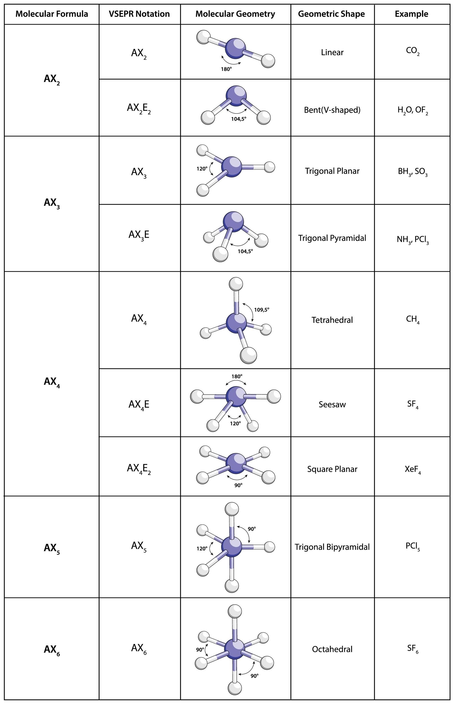

# VSEPR 理论

## 1. 核心原理：价层电子对互斥 (VSEPR)
中心原子周围的**价层电子对**（包括成键电子对 BP 和孤电子对 LP）由于带负电而互相排斥，它们会自发地在空间中尽可能远离，以达到能量最低的状态。

### 斥力大小规则
> **孤对-孤对 (LP-LP) > 孤对-成键 (LP-BP) > 成键-成键 (BP-BP)**
* **后果**：孤电子对占空间更大，会将成键电子向内“挤压”，导致键角比理想状态更小。

---

## 2. 计算三步曲：确定分子“户型”

### 第一步：计算孤电子对数 ($LP$)
$$LP = \frac{1}{2}(a - xb)$$
* **$a$**：中心原子价电子数（离子需加减电荷数）。
* **$x$**：成键原子数。
* **$b$**：成键原子达标所需电子（H 为 1，其他通常为 2）。

### 第二步：计算总电子对数 ($n$)
$$n = x + LP$$
* **$n$ 值决定了 VSEPR 模型（电子对的理想分布）和杂化类型。**

### 第三步：确定分子构型（删角法）
在理想模型的基础上，根据孤电子对的**优先占据原则**，隐去孤电子对，观察剩下的原子骨架。

---

## 3. 基础模型速查 ($n = 2, 3, 4$)

| $n$ | 杂化类型 | 理想模型 | 孤对数 $LP$ | 分子几何构型 | 实例 |
| :--- | :--- | :--- | :--- | :--- | :--- |
| **2** | $sp$ | 直线形 | 0 | **直线形** | $CO_2, BeCl_2$ |
| **3** | $sp^2$ | 平面三角形 | 0 | **平面三角形** | $BF_3, SO_3$ |
| | | | 1 | **V 形 (角形)** | $SO_2, O_3$ |
| **4** | $sp^3$ | 正四面体 | 0 | **正四面体** | $CH_4, CCl_4$ |
| | | | 1 | **三角锥形** | $NH_3, PCl_3$ |
| | | | 2 | **V 形 (角形)** | $H_2O, OF_2$ |

---

## 4. 进阶超价模型 ($n = 5, 6$)

### $n = 5$：三角双锥模型 (Trigonal Bipyramidal)
* **杂化**：$sp^3d$
* **删角规则**：孤电子对**优先占据赤道位**（中间三角形的顶点）。
* **演变流程**：
    1. **$LP = 0$**：三角双锥 ($PCl_5$)
    2. **$LP = 1$**：**跷跷板形 (Seesaw)** ($SF_4$)
    3. **$LP = 2$**：**T 形 (T-shaped)** ($ClF_3$)
    4. **$LP = 3$**：**直线形 (Linear)** ($XeF_2, I_3^-$)

### $n = 6$：正八面体模型 (Octahedral)
* **杂化**：$sp^3d^2$
* **删角规则**：第一对随便删（通常删上下顶角），第二对删在**它的对面**（$180^\circ$ 处）。
* **演变流程**：
    1. **$LP = 0$**：正八面体 ($SF_6$)
    2. **$LP = 1$**：**四方锥 (Square Pyramidal)** ($BrF_5$)
    3. **$LP = 2$**：**平面正方形 (Square Planar)** ($XeF_4$)

---

## 5. 易错点笔记 (Cheat Sheet)

1. **多重键视作一对**：在 VSEPR 中，双键或三键只占一个方向，计算 $x$ 时只算原子个数。
2. **位置不等价性**：只有在 $n=5$（三角双锥）时，位置分为轴向（Axial）和赤道向（Equatorial）。
3. **键角压缩**：只要有孤电子对，实际键角通常小于理想值（如 $H_2O$ 的 $104.5^\circ < 109.5^\circ$）。
4. **离子电荷**：
   * 阳离子（如 $NH_4^+$）：$a = 5 - 1 = 4$
   * 阴离子（如 $CO_3^{2-}$）：$a = 4 + 2 = 6$

