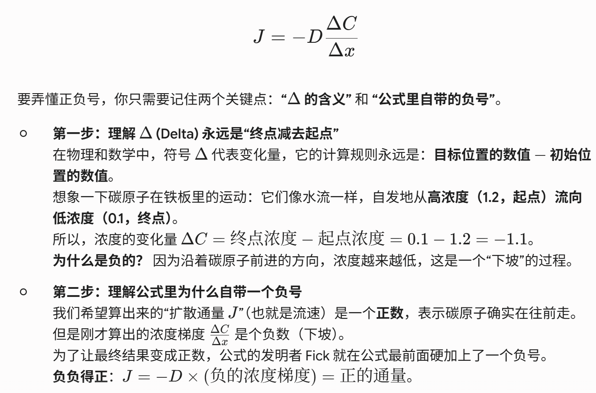

## 核心知识点梳理

### 一、 固体中的缺陷 (Imperfections in Solids)
“世界上没有绝对完美的晶体”，缺陷的存在决定了材料的许多机械和物理性能（例如导电性、屈服强度）。缺陷按几何尺寸分类：

#### 1. 点缺陷 (Point Defects) - 零维
* **空位 (Vacancies)**：晶格中缺失原子的位置。任何温度下，晶体中都存在平衡浓度的空位。
    * **空位浓度公式**：
        $$N_v = N\exp(-\frac{Q_v}{kT})$$
        * $N_v$：空位数量（或空位浓度）
        * $N$：总原子格点数（可以通过密度和原子量求出：$N = \frac{N_A \cdot \rho}{A}$，$N_A$为阿伏伽德罗常数，$\rho$为密度，$A$为原子量）
        * $Q_v$：形成一个空位所需的活化能
        * $k$：玻尔兹曼常数 ($8.62 \times 10^{-5} \text{eV/K}$)
        * $T$：绝对温度 (Kelvin)。**注意：温度越高，空位越多。**
* **间隙原子 (Interstitials)**：额外挤入晶格间隙位置的原子（通常引起较大的晶格畸变）。
* **杂质 (Impurities)**：
    * **置换固溶体 (Substitutional solid solution)**：溶质原子替换了溶剂原子。
    * **间隙固溶体 (Interstitial solid solution)**：溶质原子（如碳在铁中）填入溶剂晶格的间隙。
* **Hume-Rothery 规则（形成无限固溶体的四大条件）**：
    1.  **原子尺寸 (Atomic Size Factor)**：溶质与溶剂原子半径差须小于 15% ($\Delta r < 15\%$ )。
    2.  **晶体结构 (Crystal Structure)**：两者的纯金属晶体结构必须相同。
    3.  **电负性 (Electronegativity)**：电负性必须相近（差异大则容易形成金属间化合物，而不是固溶体）。
    4.  **化合价 (Valences)**：金属倾向于溶解较高化合价的金属，而不是较低化合价的。

#### 2. 线缺陷 (Linear Defects / Dislocations) - 一维
位错是导致金属产生塑性变形（滑移）的根本原因。
* **刃位错 (Edge Dislocation)**：一个额外的半原子面插入晶格中。**柏氏矢量 (Burgers vector, $\vec{b}$) 垂直于位错线**。
* **螺位错 (Screw Dislocation)**：晶体受剪切应力发生螺旋状错位。**柏氏矢量平行于位错线**。
* **混合位错 (Mixed Dislocation)**：兼具刃位错和螺位错的特征，柏氏矢量与位错线呈一定夹角。

#### 3. 面缺陷与体缺陷 (Planar & Bulk Defects) - 二维/三维
* **晶界 (Grain Boundaries)**：不同晶粒之间的交界面。晶界处原子排列混乱，能量较高，能阻碍位错运动（细晶强化）。
* **孪晶界 (Twin Boundaries)**：界面两侧的原子排列呈镜像对称。
* 体缺陷包括孔洞、裂纹、夹杂物等。

---

### 二、 扩散 (Diffusion)
扩散是物质内部原子迁移的现象，需要满足两个条件：1) 有空位或间隙；2) 原子有足够的能量打破现有的键（通常需要高温）。

#### 1. 扩散机制 (Diffusion Mechanisms)
* **空位扩散 (Vacancy Diffusion)**：原子从一个晶格位置跳到相邻的空位上。扩散速率取决于空位浓度和原子跃迁的活化能。（自扩散和置换原子扩散属于此类）。
* **间隙扩散 (Interstitial Diffusion)**：较小的溶质原子（如 C, H, O, N）在宿主晶格的间隙中穿梭。由于间隙总是存在的且小原子移动快，**间隙扩散通常比空位扩散快得多**。

#### 2. 稳态扩散与 Fick 第一定律 (Fick's First Law)
* **稳态扩散 (Steady-State Diffusion)**：扩散通量（单位时间通过单位面积的质量）不随时间变化。
    * **公式**：
        $$J = -D\frac{dC}{dx}$$
        * $J$：扩散通量 ($\text{kg}/(\text{m}^2 \cdot \text{s})$ 或 $\text{atoms}/(\text{m}^2 \cdot \text{s})$)
        * $D$：扩散系数 ($\text{m}^2/\text{s}$)
        * $\frac{dC}{dx}$：浓度梯度（负号表示扩散从高浓度流向低浓度）。

#### 3. 非稳态扩散与 Fick 第二定律 (Fick's Second Law)
* **非稳态扩散 (Nonsteady-State Diffusion)**：浓度是位置 $x$ 和时间 $t$ 的函数，即实际工程中最常见的渗碳、掺杂等过程。
    * **微分方程**：
        $$\frac{\partial C}{\partial t} = D\frac{\partial^2 C}{\partial x^2}$$
    * **半无限长固体的误差函数解 (Error Function Solution)**：
        $$\frac{C(x,t) - C_0}{C_s - C_0} = 1 - \text{erf}(\frac{x}{2\sqrt{Dt}})$$
        * $C(x,t)$：距离表面 $x$ 处、时间 $t$ 时的浓度。
        * $C_0$：材料初始背景浓度。
        * $C_s$：保持恒定的表面浓度。
        * $\text{erf}(z)$ 为误差函数（查表获得）。**注意：恒定参数 $\frac{x^2}{Dt} = \text{constant}$ 可用于比较相同浓度下的不同工艺时间/深度。**
    * 
        * ！！！如果你想达到相同的硬度（相同的浓度），但希望它渗入的深度加倍（$x$ 变成 $2x$），因为公式里是 $x^2$，所以你需要的时间 $t$ 不是加倍，而是需要 4 倍的时间！

#### 4. 影响扩散的因素
* **扩散物质与宿主材料**：决定了是间隙扩散还是空位扩散，以及晶格结构的紧密程度。
* **温度 (Temperature)**：扩散极其依赖温度，呈阿伦尼乌斯 (Arrhenius) 关系：
    $$D = D_0\exp(-\frac{Q_d}{RT})$$
    * $D_0$：指前因子（与温度无关的常数）。
    * $Q_d$：扩散活化能 ($\text{J/mol}$ 或 $\text{eV/atom}$)。
    * $R$：理想气体常数 ($8.314 \text{ J/(mol}\cdot\text{K)}$)。对数形式为 $\ln D = \ln D_0 - \frac{Q_d}{R}(\frac{1}{T})$，在 $\ln D$ vs $1/T$ 图中是斜率为 $-\frac{Q_d}{R}$ 的直线。

---

## 典型例题详细解析

### 例题 1：空位浓度计算 (Point Defects)
**题目**：计算纯铜在 $1000^\circ\text{C}$ 时的平衡空位浓度（每立方米的空位数）。已知纯铜的密度 $\rho = 8.4 \text{ g/cm}^3$，原子量 $A_{\text{Cu}} = 63.5 \text{ g/mol}$，空位形成能 $Q_v = 0.9 \text{ eV/atom}$，玻尔兹曼常数 $k = 8.62 \times 10^{-5} \text{ eV/K}$，阿伏伽德罗常数 $N_A = 6.02 \times 10^{23} \text{ atoms/mol}$。

**详细解析**：
1.  **统一单位**：温度必须用 Kelvin。$T = 1000 + 273 = 1273 \text{ K}$。密度 $\rho = 8.4 \text{ g/cm}^3 = 8.4 \times 10^6 \text{ g/m}^3$。
2.  **求总格点数 $N$**（即每立方米有多少个铜原子）：
    $$N = \frac{N_A \cdot \rho}{A_{\text{Cu}}} = \frac{(6.02 \times 10^{23} \text{ atoms/mol}) \times (8.4 \times 10^6 \text{ g/m}^3)}{63.5 \text{ g/mol}}$$
    $$N \approx 7.96 \times 10^{28} \text{ atoms/m}^3$$
3.  **代入空位公式**：
    $$N_v = N\exp(-\frac{Q_v}{kT})$$
    $$N_v = (7.96 \times 10^{28}) \times \exp(-\frac{0.9}{(8.62 \times 10^{-5})(1273)})$$
    指数部分 $\approx -8.2$
    $$N_v = (7.96 \times 10^{28}) \times \exp(-8.2) \approx (7.96 \times 10^{28}) \times (2.74 \times 10^{-4})$$
    $$N_v \approx 2.18 \times 10^{25} \text{ vacancies/m}^3$$
**结论**：即使在高温下，空位比例依然很小（约 $10^{-4}$ 量级），但这对扩散至关重要。

### 例题 2：Fick第二定律的应用 (渗碳问题)
**题目**：一块初始碳含量为 $0.20 \text{ wt\%}$ 的钢齿轮在 $1000^\circ\text{C}$ 下进行表面渗碳处理。渗碳炉内的气体使钢材表面碳浓度始终保持在 $1.00 \text{ wt\%}$。如果要在距离表面 $0.5 \text{ mm}$ 处达到 $0.60 \text{ wt\%}$ 的碳浓度，需要处理多长时间？（假设在该温度下碳在铁中的扩散系数 $D = 1.6 \times 10^{-11} \text{ m}^2/\text{s}$。已知当 $\text{erf}(z) = 0.5$ 时，$z \approx 0.477$）。

**详细解析**：
1.  **明确已知变量**：
    $C_0 = 0.20$, $C_s = 1.00$, $C(x,t) = 0.60$
    $x = 0.5 \text{ mm} = 5 \times 10^{-4} \text{ m}$
    $D = 1.6 \times 10^{-11} \text{ m}^2/\text{s}$
2.  **代入非稳态扩散误差函数解**：
    $$\frac{C(x,t) - C_0}{C_s - C_0} = 1 - \text{erf}(\frac{x}{2\sqrt{Dt}})$$
    $$\frac{0.60 - 0.20}{1.00 - 0.20} = 1 - \text{erf}(\frac{x}{2\sqrt{Dt}})$$
    $$\frac{0.40}{0.80} = 0.5 = 1 - \text{erf}(z)$$
    所以，$\text{erf}(z) = 0.5$
3.  **求时间 $t$**：
    根据已知条件 $\text{erf}(z) = 0.5 \Rightarrow z = 0.477$
    $$z = \frac{x}{2\sqrt{Dt}} = 0.477$$
    $$0.477 = \frac{5 \times 10^{-4}}{2\sqrt{(1.6 \times 10^{-11}) \cdot t}}$$
    $$\sqrt{t} = \frac{5 \times 10^{-4}}{2 \times 0.477 \times \sqrt{1.6 \times 10^{-11}}} = \frac{5 \times 10^{-4}}{0.954 \times 4 \times 10^{-6}} \approx 131$$
    $$t = 131^2 \approx 17161 \text{ s} \approx 4.77 \text{ hours}$$

---

## 考前自测练习题 (Practice Questions)

建议你自己动手算一下，感受一下题目的考法：

**题 1：Hume-Rothery 规则判断**
假设你有金属A和金属B。金属A为FCC结构，原子半径为 $0.125 \text{ nm}$，电负性为 1.6，化合价为 +2。金属B为BCC结构，原子半径为 $0.128 \text{ nm}$，电负性为 1.5，化合价为 +2。
请根据 Hume-Rothery 规则判断，金属A和金属B能否形成完全互溶的连续固溶体？请逐条规则说明原因。

**题 2：Fick第一定律通量计算**
一块厚度为 $2 \text{ mm}$ 的铁板，在 $700^\circ\text{C}$ 时，一侧暴露在富碳气体中，另一侧暴露在脱碳气体中。达到稳态时，富碳侧表面的碳浓度为 $1.2 \text{ kg/m}^3$，脱碳侧表面的碳浓度为 $0.1 \text{ kg/m}^3$。如果碳在铁中的扩散系数 $D = 3 \times 10^{-11} \text{ m}^2/\text{s}$，请计算通过铁板的碳扩散通量 $J$（假设浓度梯度是线性的）。

**题 3：扩散的温度依赖性**
已知某一溶质原子在某金属中的扩散活化能 $Q_d = 125,000 \text{ J/mol}$。如果在 $500^\circ\text{C}$ 时扩散系数为 $D_1$，在 $700^\circ\text{C}$ 时的扩散系数为 $D_2$。请计算比值 $\frac{D_2}{D_1}$。这说明了温度对扩散有怎样的影响？（$R = 8.31 \text{ J/(mol}\cdot\text{K)}$）。