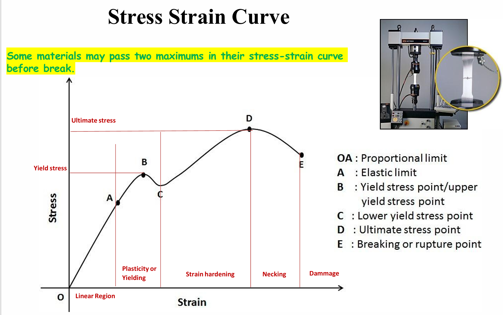
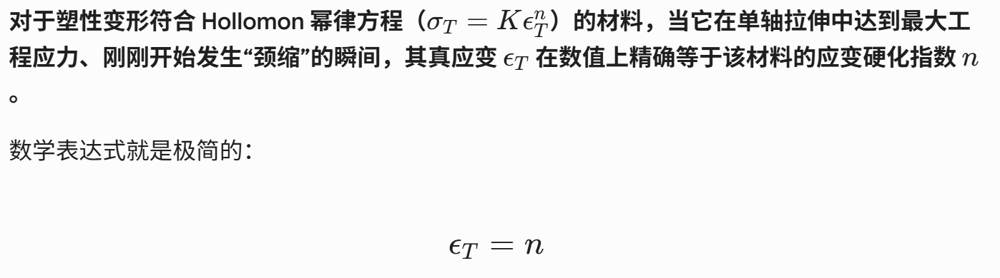

## 核心知识点梳理

### 一、 应力与应变基础 (Stress and Strain)
在评估材料的力学性能时，为了消除样品几何尺寸的影响，我们将载荷和变形转化为应力和应变。

* **工程应力 (Engineering Stress, $\sigma$)**：
  $$\sigma = \frac{F}{A_0}$$
  其中，$F$ 为施加的垂直载荷，$A_0$ 为样品的初始横截面积。单位为 MPa 或 psi。
* **工程应变 (Engineering Strain, $\epsilon$)**：
  $$\epsilon = \frac{\Delta l}{l_0} = \frac{l_i - l_0}{l_0}$$
  其中，$l_0$ 为初始标距长度，$l_i$ 为瞬时长度。应变为无量纲物理量，常以百分比表示。
* **剪切应力 ($\tau$) 与剪切应变 ($\gamma$)**：
  剪切应力是平行于受力面的力与面积的比值：$\tau = \frac{F}{A_0}$。剪切应变是变形角度的正切值：$\gamma = \tan \theta$。

### 二、 弹性变形 (Elastic Deformation)
弹性变形是可逆的变形，当外力撤除后，材料恢复原状。此阶段原子间距发生拉伸或压缩，但未发生滑移。

* **胡克定律 (Hooke's Law)**：
  在比例极限内，应力与应变成正比：
  $$\sigma = E \epsilon$$
  * $E$ 为 **杨氏模量 (Young's Modulus)**，反映材料的刚度 (Stiffness)。$E$ 越大，材料越难发生弹性变形。$E$ 的微观本质取决于原子间结合力（键能曲线在平衡距离处的曲率）。
* **泊松比 (Poisson's Ratio, $\nu$)**：
  材料在一个方向受拉伸时，会在垂直方向发生收缩。泊松比是横向应变与纵向应变的比值的负数：
  $$\nu = -\frac{\epsilon_x}{\epsilon_z} = -\frac{\epsilon_y}{\epsilon_z}$$
  对于大多数各向同性金属，$\nu$ 的值在 0.25 到 0.35 之间。
* **弹性模量关系**：
  剪切模量 $G$ 与杨氏模量 $E$ 之间的关系：
  $$E = 2G(1+\nu)$$

### 三、 塑性变形 (Plastic Deformation)
当应力超过材料的弹性极限时，发生不可逆的永久变形（微观上为位错的滑动）。

* **屈服强度 (Yield Strength, $\sigma_y$)**：
  材料开始发生明显塑性变形的临界应力。对于没有明显屈服点的金属（如铝、铜），通常采用 **0.2% 偏移法 (0.2% Offset Method)** 来确定：在应变轴上取 $\epsilon = 0.002$，画一条平行于弹性阶段直线的平行线，与应力-应变曲线的交点即为 $\sigma_y$。
* **抗拉强度 (Ultimate Tensile Strength, UTS 或 $\sigma_{TS}$)**：
  工程应力-应变曲线上的最高点。代表材料所能承受的最大工程应力。达到此点后，塑性变形不再均匀，试样局部横截面积急剧减小，发生**颈缩 (Necking)**。
* **断裂强度 (Fracture Strength)**：
  试样最终断裂时的工程应力。

### 四、 延展性、韧性与回弹能
* **延展性 (Ductility)**：
  材料在断裂前发生塑性变形的能力。常用以下两个指标衡量：
  * **断后伸长率 (Percent Elongation, %EL)**: 
    $$\%EL = \frac{l_f - l_0}{l_0} \times 100$$
  * **断面收缩率 (Percent Reduction in Area, %AR)**: 
    $$\%AR = \frac{A_0 - A_f}{A_0} \times 100$$
* **回弹能 / 弹性比功 (Modulus of Resilience, $U_r$)**：
  材料在弹性变形阶段吸收应变能并在卸载时释放该能量的能力。等于弹性阶段应力-应变曲线下的面积：
  $$U_r = \int_0^{\epsilon_y} \sigma d\epsilon = \frac{1}{2} \sigma_y \epsilon_y = \frac{\sigma_y^2}{2E}$$
* **韧性 (Toughness)**：
  材料在断裂前吸收总能量的能力（即抵抗断裂的能力）。它是**整个**应力-应变曲线下的总面积。高韧性材料必须兼具高强度和高延展性。

### 五、 真应力与真应变 (True Stress and True Strain)
工程应力在颈缩后下降，是因为使用了初始面积 $A_0$。实际上，截面变小导致真实应力仍在上升。

* **真应力 ($\sigma_T$)**：基于施力瞬间的实际横截面积 $A_i$：
  $$\sigma_T = \frac{F}{A_i}$$
* **真应变 ($\epsilon_T$)**：
  $$\epsilon_T = \int_{l_0}^{l_i} \frac{dl}{l} = \ln \left( \frac{l_i}{l_0} \right)$$
* **工程与真实的转换关系**（前提：**仅在颈缩发生之前**，体积保持不变 $A_0 l_0 = A_i l_i$ 成立）：
  $$\sigma_T = \sigma(1+\epsilon)$$
  $$\epsilon_T = \ln(1+\epsilon)$$
* **Hollomon 公式（应变硬化方程）**：
  在塑性变形阶段（至颈缩前），真应力与真应变符合幂律关系：
  $$\sigma_T = K \epsilon_T^n$$
  其中，$K$ 为强度系数，$n$ 为应变硬化指数 (Strain-hardening exponent)。$n$ 越大，材料形变硬化能力越强（通常 $n$ 取值在 0.15 到 0.5 之间）。在颈缩开始时，$n$ 在数值上等于真应变 $\epsilon_T$。

### 六、 硬度 (Hardness)
硬度是材料抵抗局部塑性变形（如压痕或划痕）的能力。硬度与抗拉强度成正相关关系。
* **常见硬度测试**：布氏硬度 (Brinell)、洛氏硬度 (Rockwell，利用压痕深度)、维氏硬度 (Vickers) 等。

---

## 典型例题详细解析

### 例题 1：模量、屈服强度与应变计算
**题目**：一根直径为 10 mm 的圆柱形钢筋受到 20,000 N 的拉力，在弹性范围内发生伸长。已知钢的杨氏模量 $E = 200 \text{ GPa}$，泊松比 $\nu = 0.3$。
(1) 计算该拉力下的工程应力。
(2) 计算纵向伸长率（工程应变）。
(3) 计算横向直径的减小量。

**解析**：
(1) **计算初始横截面积 $A_0$ 及应力 $\sigma$**：
$$A_0 = \pi \left( \frac{d_0}{2} \right)^2 = \pi \left( \frac{10 \times 10^{-3}}{2} \right)^2 = 7.854 \times 10^{-5} \text{ m}^2$$
$$\sigma = \frac{F}{A_0} = \frac{20000}{7.854 \times 10^{-5}} = 2.546 \times 10^8 \text{ Pa} = 254.6 \text{ MPa}$$

(2) **计算纵向应变 $\epsilon_z$**（利用胡克定律）：
$$\epsilon_z = \frac{\sigma}{E} = \frac{254.6 \times 10^6}{200 \times 10^9} = 1.273 \times 10^{-3}$$

(3) **计算横向直径变化量 $\Delta d$**：
根据泊松比公式 $\nu = -\frac{\epsilon_x}{\epsilon_z}$：
$$\epsilon_x = -\nu \epsilon_z = -0.3 \times (1.273 \times 10^{-3}) = -3.819 \times 10^{-4}$$
由于 $\epsilon_x = \frac{\Delta d}{d_0}$：
$$\Delta d = \epsilon_x d_0 = (-3.819 \times 10^{-4}) \times 10 \text{ mm} = -0.003819 \text{ mm}$$
直径减小了 0.003819 mm。

### 例题 2：真应力与真应变的转换
**题目**：某合金拉伸试样在工程应力 $\sigma = 400 \text{ MPa}$ 时发生均匀塑性变形，此时测得的工程应变为 $\epsilon = 0.15$。该阶段材料服从 Hollomon 公式 $\sigma_T = K \epsilon_T^n$，已知 $n = 0.22$。
(1) 计算此时的真应力与真应变。
(2) 求强度系数 $K$。

**解析**：
(1) **由于发生的是均匀变形（未颈缩），可以使用转换公式**：
真应力：
$$\sigma_T = \sigma(1+\epsilon) = 400 \times (1 + 0.15) = 460 \text{ MPa}$$
真应变：
$$\epsilon_T = \ln(1+\epsilon) = \ln(1.15) \approx 0.1398$$

(2) **计算 $K$**：
代入 Hollomon 公式 $\sigma_T = K \epsilon_T^n$：
$$460 = K (0.1398)^{0.22}$$
$$K = \frac{460}{(0.1398)^{0.22}} = \frac{460}{0.6508} \approx 706.8 \text{ MPa}$$

---

## 考前自测练习题 (Practice Questions)

**题 1：基本力学性能识别**
在室温拉伸试验中，获得了一种未知金属的工程应力-应变曲线。已知该曲线的线性段起点为原点，终点坐标为应变 0.002，应力 150 MPa。在应变 0.10 时达到最大应力点 350 MPa。试样最终在应变 0.15、应力 280 MPa 处断裂。
(1) 计算该材料的杨氏模量 $E$。
(2) 估算该材料的弹性比功 (Modulus of Resilience, $U_r$)。
(3) 该材料的抗拉强度 (UTS) 是多少？

**题 2：真真与工程转换及极限**
一根初始长度为 50 mm、初始直径为 12 mm 的拉伸试样，在承受 35,000 N 拉力时发生了颈缩。此时试样的长度变为 60 mm。
(1) 计算颈缩开始时的工程应力和工程应变。
(2) 计算颈缩开始时的真应力和真应变。
(3) 根据颈缩发生时的力学特性，推测该材料的应变硬化指数 $n$ 为多少？（提示：回顾颈缩点真应变与 $n$ 的关系）。
