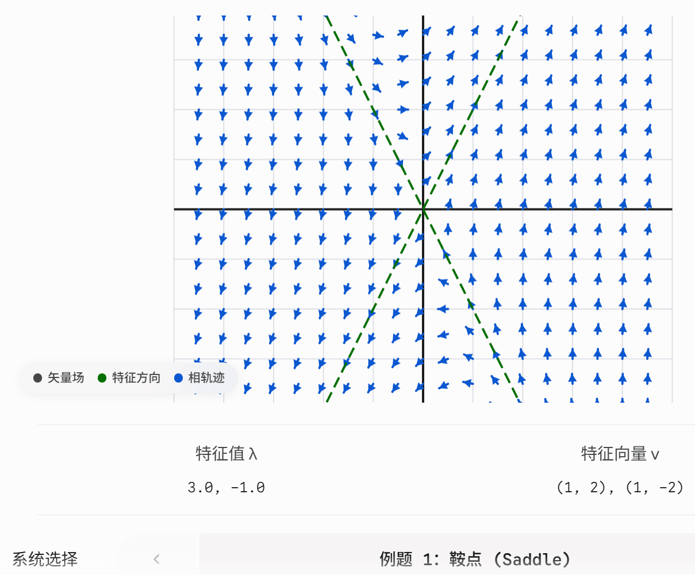
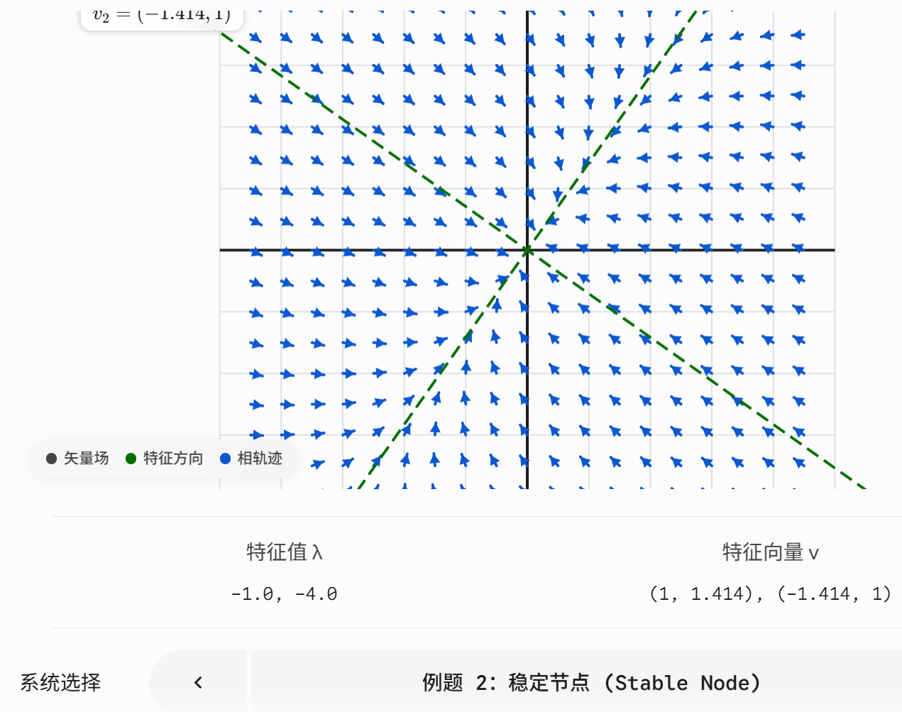

# 常微分方程 (ODE) 第十一讲：一阶线性微分方程

本讲我们将视线从单一的微分方程转向**微分方程组**。重点研究形如 $\overline{X}' = A\overline{X}$ 的**常系数齐次线性方程组**（其中 $A$ 是 $2 \times 2$ 矩阵）。

---

## 一、 核心求解思想：特征值与特征向量法

对于方程组 $\overline{X}' = A\overline{X}$，我们猜测它的解具有指数形式：
$$\overline{X}(t) = e^{rt} \overline{v}$$
其中 $r$ 是常数，$\overline{v}$ 是一个常数向量。

将这个猜测代入原方程，求导得 $\overline{X}' = r e^{rt} \overline{v}$。
于是有：$r e^{rt} \overline{v} = A (e^{rt} \overline{v})$。
消去 $e^{rt}$，我们得到一个极其经典的线性代数方程：
$$A \overline{v} = r \overline{v} \implies (A - rI)\overline{v} = 0$$

**【结论】**：要使 $\overline{X} = e^{rt} \overline{v}$ 成为解，必须满足：
1. **$r$ 是矩阵 $A$ 的特征值 (Eigenvalue)**，即满足 $\det(A - rI) = 0$。
2. **$\overline{v}$ 是对应于特征值 $r$ 的特征向量 (Eigenvector)**。

如果矩阵 $A$ 有两个**不相等且为实数**的特征值 $\lambda_1$ 和 $\lambda_2$，对应特征向量 $\overline{v}^{(1)}$ 和 $\overline{v}^{(2)}$，那么方程组的**通解**为：
$$\overline{X}(t) = c_1 e^{\lambda_1 t} \overline{v}^{(1)} + c_2 e^{\lambda_2 t} \overline{v}^{(2)}$$

---

## 二、 相图 (Phase Portrait) 与 临界点分析

通过观察两个实数特征值 $\lambda_1$ 和 $\lambda_2$ 的符号，我们可以判断系统在原点 (0,0) 的物理形态：
1. **鞍点 (Saddle point)**：特征值符号**一正一负**（异号）。系统在一个方向上吸引，在另一个方向上排斥。
2. **节点 (Node)**：特征值符号**相同**（同号）。
   * **渐近稳定 (Asymptotically stable)**：两个特征值**全为负**。轨迹全部指向原点。
   * **渐近不稳定 (Asymptotically unstable)**：两个特征值**全为正**。轨迹全部远离原点。

---

## 三、 幻灯片例题超详细解析 (绝不跳步)

### 【例题 1】：一般相异实根型
**题目**：求 $\overline{X}' = \begin{pmatrix} 1 & 1 \\ 4 & 1 \end{pmatrix} \overline{X}$ 的通解。
**解析**：
**Step 1：求特征值**
计算行列式 $\det(A - rI) = 0$：
$$\begin{vmatrix} 1 - r & 1 \\ 4 & 1 - r \end{vmatrix} = (1 - r)^2 - 4 = 0$$
展开得：$r^2 - 2r + 1 - 4 = 0 \implies r^2 - 2r - 3 = 0$
因式分解：$(r - 3)(r + 1) = 0$
得到两个不同的实数特征值：$r_1 = 3, \quad r_2 = -1$。
*(注：一正一负，原点是**鞍点**)*。

**Step 2：求对应特征向量**
* 对于 $r_1 = 3$：求解 $(A - 3I)\overline{v} = 0$
  $$\begin{pmatrix} 1-3 & 1 \\ 4 & 1-3 \end{pmatrix} \begin{pmatrix} x \\ y \end{pmatrix} = \begin{pmatrix} -2 & 1 \\ 4 & -2 \end{pmatrix} \begin{pmatrix} x \\ y \end{pmatrix} = \begin{pmatrix} 0 \\ 0 \end{pmatrix}$$
  第一行方程为 $-2x + y = 0 \implies y = 2x$。
  令 $x = 1$，则 $y = 2$。得到特征向量 $\overline{v}^{(1)} = \begin{pmatrix} 1 \\ 2 \end{pmatrix}$。

* 对于 $r_2 = -1$：求解 $(A - (-1)I)\overline{v} = 0$
  $$\begin{pmatrix} 1+1 & 1 \\ 4 & 1+1 \end{pmatrix} \begin{pmatrix} x \\ y \end{pmatrix} = \begin{pmatrix} 2 & 1 \\ 4 & 2 \end{pmatrix} \begin{pmatrix} x \\ y \end{pmatrix} = \begin{pmatrix} 0 \\ 0 \end{pmatrix}$$
  第一行方程为 $2x + y = 0 \implies y = -2x$。
  令 $x = 1$，则 $y = -2$。得到特征向量 $\overline{v}^{(2)} = \begin{pmatrix} 1 \\ -2 \end{pmatrix}$。

**Step 3：写出通解**
$$\overline{X}(t) = c_1 e^{3t} \begin{pmatrix} 1 \\ 2 \end{pmatrix} + c_2 e^{-t} \begin{pmatrix} 1 \\ -2 \end{pmatrix}$$

---

### 【例题 2】：带根号的矩阵计算
**题目**：求 $\overline{X}' = \begin{pmatrix} -3 & \sqrt{2} \\ \sqrt{2} & -2 \end{pmatrix} \overline{X}$ 的通解。
**解析**：
**Step 1：求特征值**
$$\begin{vmatrix} -3 - r & \sqrt{2} \\ \sqrt{2} & -2 - r \end{vmatrix} = (-3-r)(-2-r) - (\sqrt{2})^2 = (r^2 + 5r + 6) - 2 = 0$$
即 $r^2 + 5r + 4 = 0 \implies (r+1)(r+4) = 0$。
得到特征值：$r_1 = -1, \quad r_2 = -4$。
*(注：全是负数，原点是**稳定节点**)*。

**Step 2：求对应特征向量**
* 对于 $r_1 = -1$：
  $$\begin{pmatrix} -3-(-1) & \sqrt{2} \\ \sqrt{2} & -2-(-1) \end{pmatrix} = \begin{pmatrix} -2 & \sqrt{2} \\ \sqrt{2} & -1 \end{pmatrix}$$
  列方程 $-2x + \sqrt{2}y = 0 \implies \sqrt{2}y = 2x \implies y = \sqrt{2}x$。
  令 $x = 1$，得到 $\overline{v}^{(1)} = \begin{pmatrix} 1 \\ \sqrt{2} \end{pmatrix}$。

* 对于 $r_2 = -4$：
  $$\begin{pmatrix} -3-(-4) & \sqrt{2} \\ \sqrt{2} & -2-(-4) \end{pmatrix} = \begin{pmatrix} 1 & \sqrt{2} \\ \sqrt{2} & 2 \end{pmatrix}$$
  列方程 $x + \sqrt{2}y = 0 \implies x = -\sqrt{2}y$。
  令 $y = 1$，得到 $\overline{v}^{(2)} = \begin{pmatrix} -\sqrt{2} \\ 1 \end{pmatrix}$。

**Step 3：写出通解**
$$\overline{X}(t) = c_1 e^{-t} \begin{pmatrix} 1 \\ \sqrt{2} \end{pmatrix} + c_2 e^{-4t} \begin{pmatrix} -\sqrt{2} \\ 1 \end{pmatrix}$$

---

## 四、 基础矩阵 (Fundamental Matrices)

如果系统有 $n$ 个线性无关的解向量 $\overline{X}^{(1)}(t), \dots, \overline{X}^{(n)}(t)$，我们把它们**按列排起来**，构成一个 $n \times n$ 的矩阵，这个矩阵叫做**基础矩阵 $\Psi(t)$**：
$$\Psi(t) = \big( \overline{X}^{(1)}(t) \ | \ \dots \ | \ \overline{X}^{(n)}(t) \big)$$

**【考点】：寻找特殊的 $\Phi(t)$**
有时候题目会要求寻找一个特殊的标准基础矩阵 $\Phi(t)$，使得在 $t=0$ 时刻，它等于单位矩阵，即 **$\Phi(0) = I$**。
**黄金公式**：利用普通的基础矩阵 $\Psi(t)$，可以通过下式直接求出特殊的 $\Phi(t)$：
$$\Phi(t) = \Psi(t) \cdot \Psi(0)^{-1}$$

### 【完整实战】：求例题 1 的 $\Phi(t)$
已知 $\overline{X}' = \begin{pmatrix} 1 & 1 \\ 4 & 1 \end{pmatrix} \overline{X}$ 的两个解分别是 $\overline{X}^{(1)} = \begin{pmatrix} e^{3t} \\ 2e^{3t} \end{pmatrix}$ 和 $\overline{X}^{(2)} = \begin{pmatrix} e^{-t} \\ -2e^{-t} \end{pmatrix}$。

**Step 1：写出普通基础矩阵 $\Psi(t)$**
$$\Psi(t) = \begin{pmatrix} e^{3t} & e^{-t} \\ 2e^{3t} & -2e^{-t} \end{pmatrix}$$

**Step 2：计算 $\Psi(0)$ 及其逆矩阵 $\Psi(0)^{-1}$**
代入 $t=0$：
$$\Psi(0) = \begin{pmatrix} 1 & 1 \\ 2 & -2 \end{pmatrix}$$
求二阶矩阵的逆（公式：$\frac{1}{ad-bc}\begin{pmatrix} d & -b \\ -c & a \end{pmatrix}$）：
行列式 $\det = 1(-2) - 1(2) = -4$
$$\Psi(0)^{-1} = -\frac{1}{4} \begin{pmatrix} -2 & -1 \\ -2 & 1 \end{pmatrix} = \begin{pmatrix} 1/2 & 1/4 \\ 1/2 & -1/4 \end{pmatrix}$$

**Step 3：矩阵相乘得到 $\Phi(t)$**
$$\Phi(t) = \Psi(t) \cdot \Psi(0)^{-1} = \begin{pmatrix} e^{3t} & e^{-t} \\ 2e^{3t} & -2e^{-t} \end{pmatrix} \begin{pmatrix} 1/2 & 1/4 \\ 1/2 & -1/4 \end{pmatrix}$$
按照矩阵乘法规则（行乘列）：
* 第一行第一列：$e^{3t}(\frac{1}{2}) + e^{-t}(\frac{1}{2}) = \frac{1}{2}e^{3t} + \frac{1}{2}e^{-t}$
* 第一行第二列：$e^{3t}(\frac{1}{4}) + e^{-t}(-\frac{1}{4}) = \frac{1}{4}e^{3t} - \frac{1}{4}e^{-t}$
* 第二行第一列：$2e^{3t}(\frac{1}{2}) + (-2e^{-t})(\frac{1}{2}) = e^{3t} - e^{-t}$
* 第二行第二列：$2e^{3t}(\frac{1}{4}) + (-2e^{-t})(-\frac{1}{4}) = \frac{1}{2}e^{3t} + \frac{1}{2}e^{-t}$

**最终答案**：
$$\Phi(t) = \begin{pmatrix} \frac{1}{2}e^{3t} + \frac{1}{2}e^{-t} & \frac{1}{4}e^{3t} - \frac{1}{4}e^{-t} \\ e^{3t} - e^{-t} & \frac{1}{2}e^{3t} + \frac{1}{2}e^{-t} \end{pmatrix}$$
*(你可以代入 $t=0$ 检验一下，确实等于单位矩阵 $\begin{pmatrix} 1 & 0 \\ 0 & 1 \end{pmatrix}$！)*
