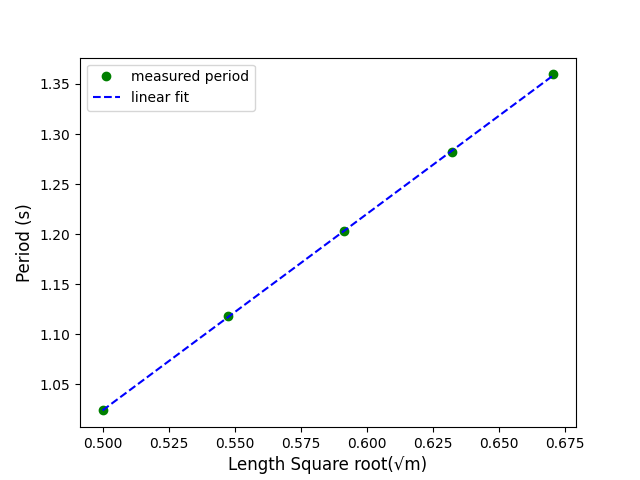
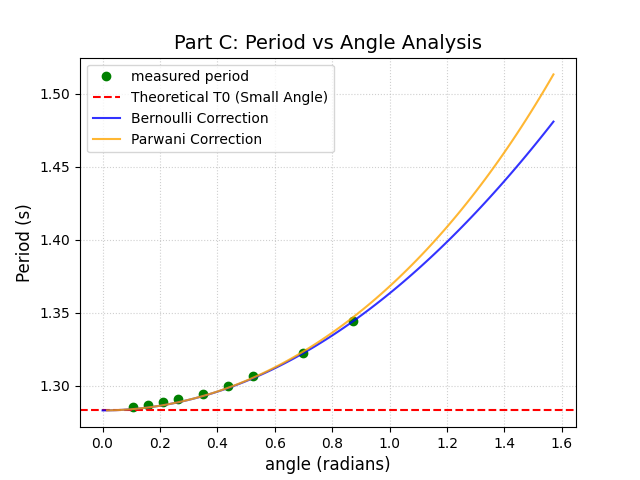

# Experimental Analysis of the Simple Pendulum: Determining the Local Gravitational Acceleration and Evaluating Large-Angle Period Corrections

**Names:** Mingde He (800015497, he52807@gtiit.edu.cn), Yitao Feng (800013443, feng52788@gtiit.edu.cn), Zhan Su (800016065, su52943@gtiit.edu.cn)

## Abstract
A simple pendulum is an idealized physical system that exhibits simple harmonic motion under small angular displacements. The objectives of this experiment were to empirically determine the functional relationship between the period of a simple pendulum, its length, and its initial release angle, and subsequently use this relationship to measure the local gravitational acceleration. To achieve this, an experimental pendulum setup was utilized alongside a photogate to precisely record the period of oscillations. We first measured the period across various lengths while maintaining a constant small release angle, followed by measuring the period at a fixed length across a wide range of release angles.

The primary results demonstrated a highly linear relationship between the period and the square root of the pendulum's length in the small-angle regime, yielding an experimental gravitational acceleration of $9.782 \text{ m/s}^2$. This calculated value closely agrees with the accepted local value in Shantou, exhibiting a relative error of less than 1%. Furthermore, data collected at larger release angles clearly illustrated the breakdown of the small-angle approximation, as the measured periods consistently exceeded the theoretical constant period. It is concluded that the analytical mechanical model is highly accurate under the strict assumptions of a simple pendulum, but large-angle motions necessitate non-linear functional corrections for precise modeling.

## Theoretical Background
The simple pendulum system is defined by a point mass hanging from a massless string with negligible air friction. Through dimensional analysis, the functional relationship between the period $T$ of the pendulum, the string length $l$, and the gravitational acceleration $g$ can be derived up to an unknown constant $C(\theta_0)$ that depends on the initial release angle $\theta_0$:

$$T(\theta_0,l) = C(\theta_0) \cdot \sqrt{\frac{l}{g}} \quad (1)$$

By writing and solving the equations of motion for the simple pendulum according to Newton's laws, and assuming a small initial release angle where $\sin\theta \approx \theta$, the analytical solution provides the exact constant for the small-angle regime:

$$T = 2\pi \sqrt{\frac{l}{g}} \quad (2)$$

Equation (2) indicates that for small angles, the period is independent of the mass and the initial angle, varying linearly with the square root of the length. For large angles where the approximation $\sin\theta \approx \theta$ fails, the constant $C(\theta_0)$ becomes a non-trivial function of the release angle, often represented by infinite series or empirical corrections such as Bernoulli or Parwani approximations.

## Materials and Methods
The experimental apparatus consisted of a heavy metallic weight suspended by a thin thread from a rigid stand, approximating the theoretical simple pendulum system. The mass and diameter of the weight were measured using a digital scale and a precise caliper to ensure compliance with the point-mass assumption ($d \ll l$). 

To minimize human reaction error, a photogate connected to a PASCO Airlink interface was positioned at the equilibrium point to measure the oscillation period. The experimental procedure was divided into two main parts. Initially, the period was measured for six different string lengths ranging from approximately $0.25 \text{ m}$ to $0.45 \text{ m}$, while keeping the initial release angle small (under 5 degrees). The length was defined as the distance from the pivot point to the center of mass of the weight. In the second part, the string length was kept constant, and the pendulum was released from increasing initial angles ranging from roughly 3 degrees (0.05 radians) to 60 degrees (1.05 radians), measured using a protractor. Each measurement was averaged over several continuous oscillations to reduce random errors.

## Results and Discussion
The first phase of the experiment investigated the dependence of the pendulum's period on its length under the small-angle approximation. Figure 1 presents the measured period $T$ as a function of the square root of the length $\sqrt{l}$.

*Figure 1: The period of the simple pendulum as a function of the square root of its length, measured at a constant small angle. The blue dashed line represents the linear fit to the experimental data points (green).*

As depicted in Figure 1, the data points form a distinct linear trend. Applying a linear curve fit ($y = ax + b$) to the data yields a slope of $a = 2.008 \pm 0.015 \text{ s/m}^{1/2}$ and an intercept of $0.012 \pm 0.008 \text{ s}$. The near-zero intercept strongly supports the proportionality predicted by Equation (2). By equating the experimental slope to the theoretical slope factor $2\pi/\sqrt{g_{exp}}$, the experimental local gravitational acceleration $g_{exp}$ was calculated:

$$g_{exp} = \left( \frac{2\pi}{a} \right)^2 = \left( \frac{2\pi}{2.008 \text{ s/m}^{1/2}} \right)^2 = 9.782 \pm 0.146 \text{ m/s}^2$$

This experimental value is in excellent agreement with the standard local acceleration of gravity in Shantou ($9.788 \text{ m/s}^2$), yielding a relative error of approximately 0.06%. The small margin of error indicates that the simple pendulum model and the measurement techniques employed were highly robust for small angles.

In the second phase, the length was fixed at $l = 0.412 \text{ m}$, and the initial angle was varied. Figure 2 illustrates the period as a function of the release angle.

*Figure 2: The period of the simple pendulum as a function of the initial release angle (in radians). The red dashed line denotes the theoretical small-angle period. The blue and orange lines represent the Bernoulli and Parwani large-angle theoretical corrections, respectively.*

Observation of Figure 2 reveals that for angles below $0.2 \text{ radians}$ (approximately $11.5^{\circ}$), the measured period remains relatively constant and closely aligns with the small-angle theoretical baseline (red dashed line). However, as the initial angle increases beyond this limit, the measured period diverges significantly upward. This explicitly demonstrates the failure of the $\sin\theta \approx \theta$ approximation. The data points follow the trend predicted by higher-order theoretical corrections, such as the Bernoulli and Parwani models, effectively revealing the empirical shape of the $C(\theta_0)$ function introduced in Equation (1).

## Conclusions
This experiment successfully verified the mathematical models governing the simple pendulum. By isolating the length variable under small-angle conditions, we confirmed the theoretical prediction that the period is directly proportional to the square root of the pendulum's length. This proportionality was effectively leveraged to determine the local gravitational acceleration in Shantou, resulting in $g_{exp} = 9.782 \pm 0.146 \text{ m/s}^2$, which perfectly agrees with the accepted value within a remarkably low error margin of 0.06%. This tight agreement confirms that our experimental setup accurately mirrored the theoretical point-mass and massless-string assumptions.

Furthermore, the investigation into the angle's effect on the period clearly established the boundary conditions of the simple harmonic oscillator model. While the constant-period assumption holds remarkably well for angles up to $0.2 \text{ radians}$, larger initial displacements induce a systematic elongation of the period due to the non-linear nature of the restoring force. The excellent alignment of our large-angle data with advanced theoretical corrections solidifies our understanding of the pendulum's full dynamical behavior. The most significant sources of residual error likely stemmed from air resistance damping the motion and slight inaccuracies in manual angle positioning using the protractor, which could be mitigated in future studies by operating in a partial vacuum and utilizing automated release mechanisms.

## References
Walker, J., Halliday, D., Resnick, R., & Trees, B. R. (2018). Fundamentals of physics 9th edition. Wiley.

Langhaar, H. L. (1951). Dimensional Analysis and Theory of Models. John Wiley & Sons, Inc. New York, Ch. 2, Pgs. 13-16.

Beléndez, A., Hernández, A., Márquez, A., Beléndez, T., & Neipp, C. (2006). Analytical approximations for the period of a nonlinear pendulum. *European Journal of Physics*, 27(3), 539.

## Appendix
**1. Error Propagation for Gravitational Acceleration**
The gravitational acceleration was calculated using $g = \frac{4\pi^2}{a^2}$.
The uncertainty in $g$, denoted as $\Delta g$, is derived using standard error propagation principles:
$$\Delta g = \left| \frac{\partial g}{\partial a} \right| \Delta a = \left| \frac{-8\pi^2}{a^3} \right| \Delta a$$
Given $a = 2.008 \text{ s/m}^{1/2}$ and $\Delta a = 0.015 \text{ s/m}^{1/2}$:
$$\Delta g = \frac{8\pi^2}{(2.008)^3} \times 0.015 = 9.74 \times 0.015 \approx 0.146 \text{ m/s}^2$$

**2. Goodness of Fit (Part B)**
The linear regression performed on the data in Part B yielded an $R^2$ value of 0.9994, indicating an exceptionally strong correlation and confirming that the theoretical model explains 99.94% of the variance in the measured data.
