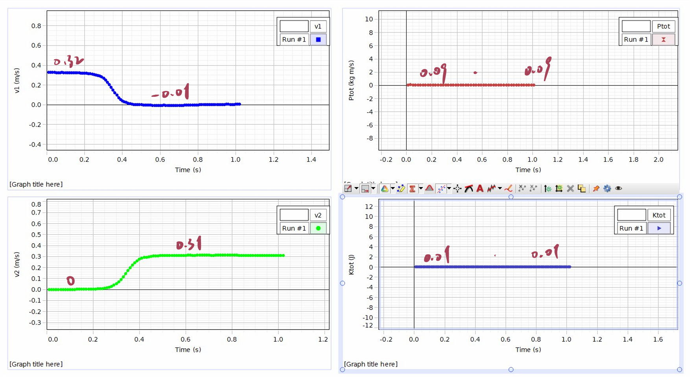
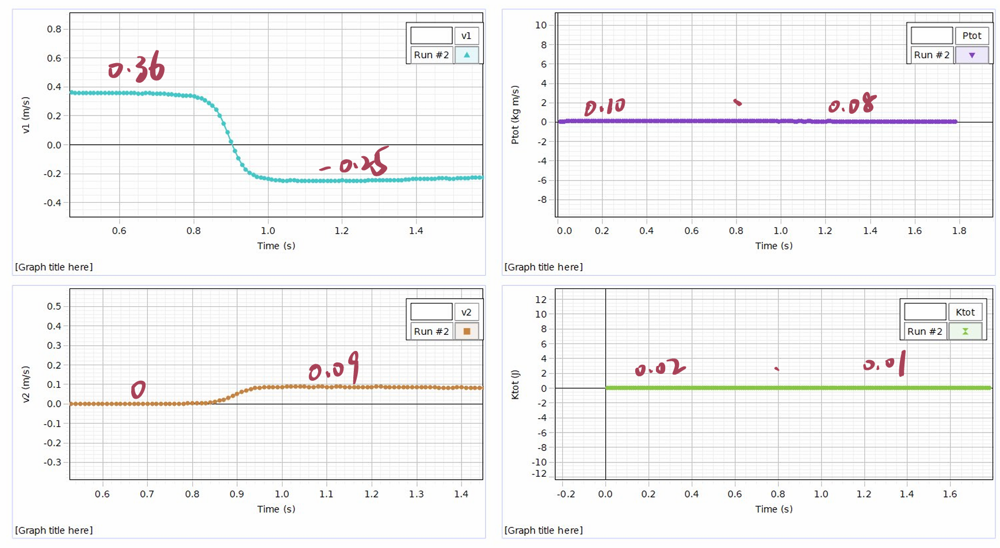
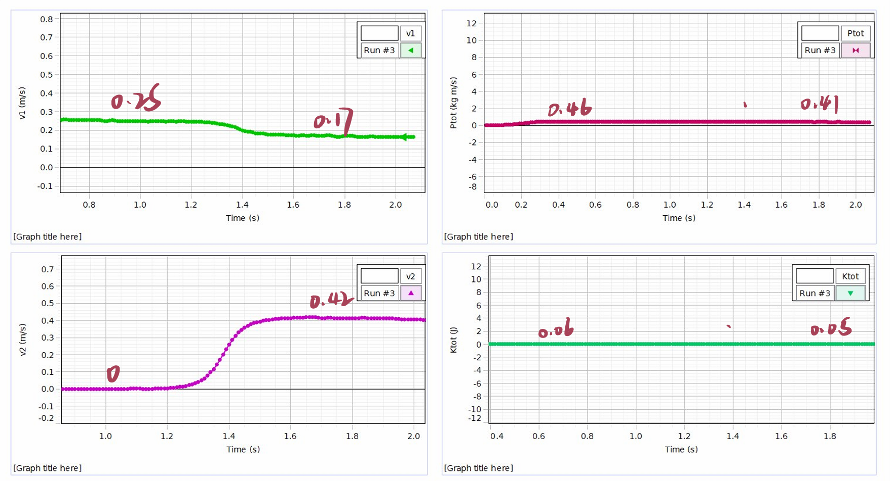
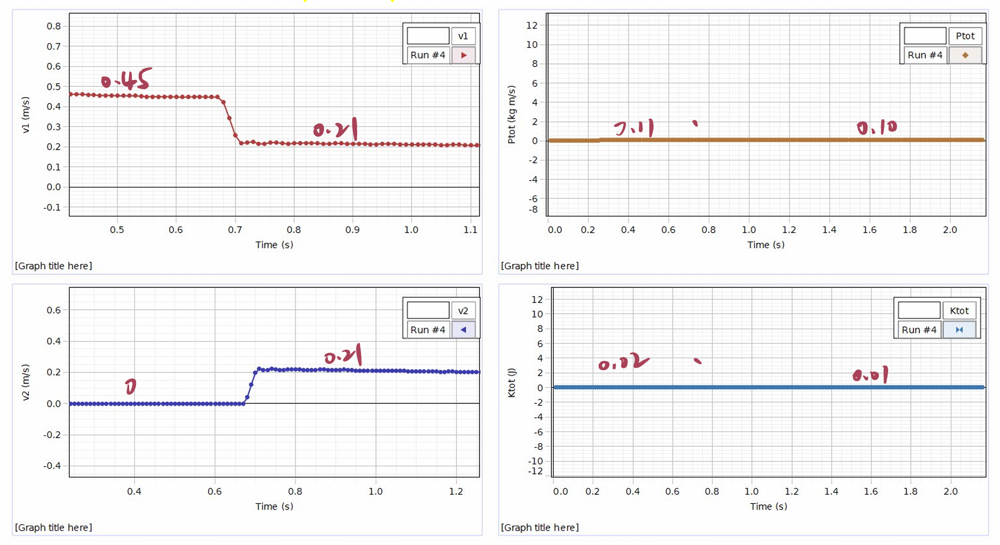
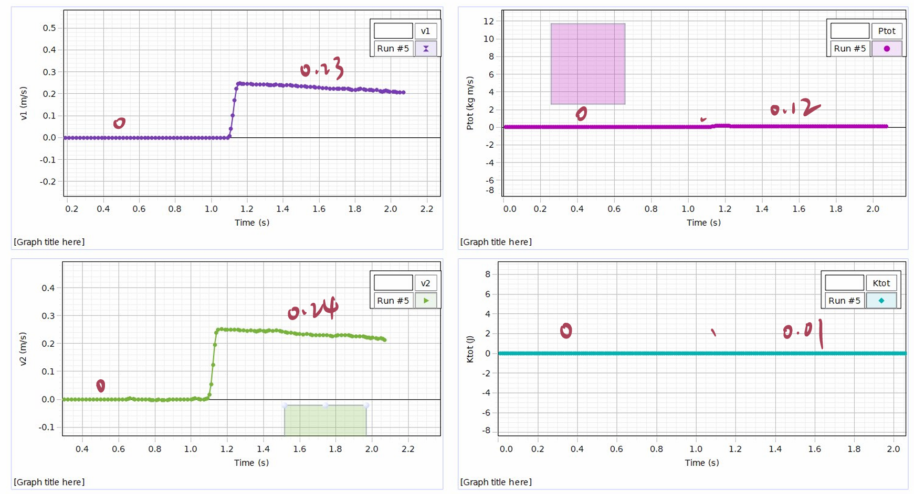
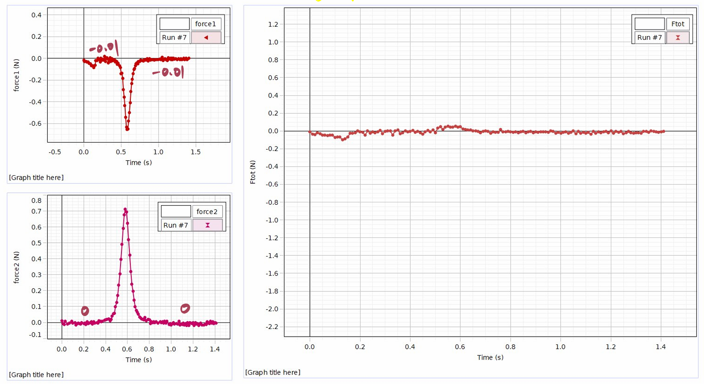
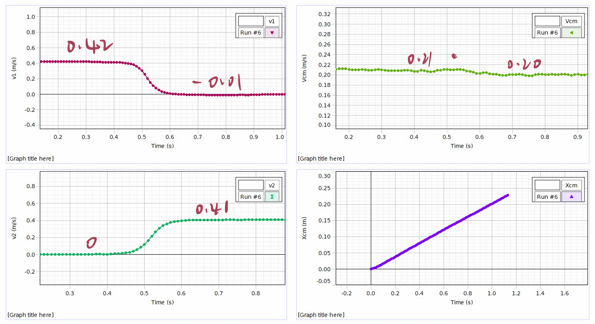

# Experimental Analysis of Momentum and Kinetic Energy Conservation in One-Dimensional Collisions

**Student 1:** Mingde He, 800015497, he52807@gtiit.edu.cn  
**Student 2:** Yitao Feng, 800013443, feng52788@gtiit.edu.cn  
**Student 3:** Zhan Su, 800016065, su52943@gtiit.edu.cn

## Abstract
This experiment investigates the principles of linear momentum and kinetic energy conservation within an isolated mechanical system. Using PASCO smart carts on a leveled aluminum track, we simulated five one-dimensional interaction scenarios: equal-mass elastic collisions, heavy-target elastic collisions, heavy-projectile elastic collisions, completely inelastic collisions, and explosions. The kinematic and force data were continuously recorded via Bluetooth sensors and analyzed using Capstone software. 

Our analysis reveals that in interactions where system parameters were correctly configured, linear momentum was conserved. Kinetic energy was conserved exclusively in elastic interactions, while it decreased in inelastic collisions (due to dissipative forces like heat and deformation) and increased during explosions (due to the release of stored potential energy). Furthermore, the motion of the center of mass remained constant regardless of internal force exchanges. We also identified and analyzed systematic discrepancies in the software readouts (e.g., in the heavy-cart and explosion trials) caused by un-updated mass variables and sensor sign conventions, demonstrating the strict validity of the physical laws despite software configuration artifacts.

## Theoretical Background
The mechanical state of a moving object is defined by its kinetic energy and linear momentum. The kinetic energy ($K$) of an object with mass $m$ moving at velocity $v$ is given by:
$$K=\frac{1}{2}mv^{2}$$ (1)
The linear momentum ($\vec{p}$) is a vector quantity defined as:
$$\vec{p}=m\vec{v}$$ (2)
According to Newton's Second Law, the net external force ($\vec{F}_{ext,tot}$) acting on a system equals the time rate of change of its total momentum ($\vec{p}_{tot}$):
$$\vec{F}_{ext,tot}=\frac{d\vec{p}_{tot}}{dt}$$ (3)
If there are no external forces ($\vec{F}_{ext,tot}=0$), the total momentum of the system is conserved over time. For a collision between two objects, this is expressed as:
$$\vec{p}_{tot,before}=\vec{p}_{tot,after}$$ (4)
In an elastic collision, conservative internal forces govern the interaction, meaning the total kinetic energy is also conserved. In a completely inelastic collision, the objects stick together, and kinetic energy is lost. In an explosion, stored internal energy is released, resulting in a higher final kinetic energy.

Furthermore, the velocity of the center of mass ($\vec{v}_{CM}$) for a one-dimensional system of particles is defined as:
$$\vec{v}_{CM}=\frac{\Sigma_{i}m_{i}\vec{v}_{i}}{\Sigma_{i}m_{i}}$$ (5)
In an isolated system without external forces, the velocity of the center of mass remains constant regardless of internal collisions.

*(Note: Detailed derivations of final velocities for 1D elastic collisions and numerical error propagation calculations are provided in the Appendix.)*

## Material and Methods

To investigate these physical principles, the experimental setup consisted of a 1.2 m leveled aluminum track and two PASCO smart carts (one red, one blue) equipped with onboard position and force sensors. Magnetic bumpers were utilized to simulate elastic collisions, Velcro bumpers were used for completely inelastic collisions, and a built-in spring plunger was engaged to mimic an explosion event. 

*Fig 1: Experimental setup diagram. (Track, carts, and added weights).*

The masses of the carts, the extra weight bars, and the heavy target weights were measured directly using a digital scale to ensure precision. The static measured quantities, alongside their instrumental uncertainties, are presented in Table 1.

**Table 1: Directly Measured Masses of the Equipment**
| Item | Mass (± 0.00005 kg) |
| :--- | :--- |
| Red Cart ($m_R$) | 0.2749 |
| Blue Cart ($m_B$) | 0.2714 |
| Two Extra Mass Bars | 0.5043 |
| 1 kg Weight | 0.9992 |

During the execution of the experiment, the carts were connected to PASCO Capstone software to continuously record velocity. The positive x-direction was strictly defined as moving to the right. To calculate derived quantities, an instrumental uncertainty of ± 0.01 m/s was assumed for the velocity readings extracted from the software highlighter tool.

## Results and Discussion

To systematically evaluate the conservation of momentum and energy, we extracted the initial and final states for each individual cart immediately before and after the interaction interval across all five scenarios.

### Part B: Elastic Collisions

**1. Equal Masses**
To test ideal elastic behavior without mass disparity, we collided the red cart into the stationary blue cart. Figure 2 displays the recorded velocities, total momentum, and total kinetic energy over time. *(Note: Software settings were adjusted to display raw sampling data as discrete points).*

*Fig 2: Kinematic data for an equal-mass elastic collision.*

As observed in Figure 2, the carts nearly perfectly exchange velocities upon impact. To verify conservation quantitatively, the individual parameters for each cart are calculated and presented in Table 2.

**Table 2: Individual and System States for Equal-Mass Collision**
| Parameter | Initial State (Before) | Final State (After) |
| :--- | :--- | :--- |
| Red Cart Velocity ($v_R$) | 0.31 ± 0.01 m/s | 0.00 ± 0.01 m/s |
| Red Cart Momentum ($p_R$) | 0.085 ± 0.003 kg·m/s | 0.000 ± 0.003 kg·m/s |
| Red Cart Kinetic Energy ($K_R$) | 0.013 ± 0.001 J | 0.000 ± 0.001 J |
| Blue Cart Velocity ($v_B$) | -0.01 ± 0.01 m/s | 0.32 ± 0.01 m/s |
| Blue Cart Momentum ($p_B$) | -0.003 ± 0.003 kg·m/s | 0.087 ± 0.003 kg·m/s |
| Blue Cart Kinetic Energy ($K_B$) | 0.000 ± 0.001 J | 0.014 ± 0.001 J |
| **Total Momentum ($P_{tot}$)** | **0.082 ± 0.004 kg·m/s** | **0.087 ± 0.004 kg·m/s** |
| **Total Kinetic Energy ($K_{tot}$)**| **0.013 ± 0.001 J** | **0.014 ± 0.001 J** |

Comparing the initial and final total states, both momentum and kinetic energy fall within the calculated uncertainty bounds, successfully demonstrating conservation in an equal-mass scenario.

**2. Heavy Target & Heavy Projectile**
To observe the effects of mass asymmetry, we conducted two additional elastic trials: colliding a light red cart into a heavily loaded blue cart ($m_{B,new} = 1.7749$ kg), and subsequently reversing the roles ($m_{R,new} = 1.7784$ kg). Figures 3 and 4 display the respective kinematics. 

*Fig 3: Kinematic data for a heavy-target elastic collision.*

**Table 3: Individual and System States for Heavy Target Collision**
| Parameter | Initial State (Before) | Final State (After) |
| :--- | :--- | :--- |
| Red Cart Velocity ($v_R$) | 0.36 ± 0.01 m/s | -0.25 ± 0.01 m/s |
| Red Cart Momentum ($p_R$) | 0.099 ± 0.003 kg·m/s | -0.069 ± 0.003 kg·m/s |
| Red Cart K.E. ($K_R$) | 0.018 ± 0.001 J | 0.009 ± 0.001 J |
| Heavy Blue Velocity ($v_B$) | 0.00 ± 0.01 m/s | 0.10 ± 0.01 m/s |
| Heavy Blue Momentum ($p_B$) | 0.000 ± 0.018 kg·m/s | 0.177 ± 0.018 kg·m/s |
| Heavy Blue K.E. ($K_B$) | 0.000 ± 0.002 J | 0.009 ± 0.002 J |
| **Physical Total Momentum** | **0.099 ± 0.018 kg·m/s** | **0.108 ± 0.018 kg·m/s** |
| **Physical Total K.E.** | **0.018 ± 0.002 J** | **0.018 ± 0.002 J** |

*Fig 4: Kinematic data for a heavy-projectile elastic collision.*

**Table 4: Individual and System States for Heavy Projectile Collision**
| Parameter | Initial State (Before) | Final State (After) |
| :--- | :--- | :--- |
| Heavy Red Velocity ($v_R$) | 0.25 ± 0.01 m/s | 0.17 ± 0.01 m/s |
| Heavy Red Momentum ($p_R$) | 0.445 ± 0.018 kg·m/s | 0.302 ± 0.018 kg·m/s |
| Heavy Red K.E. ($K_R$) | 0.056 ± 0.004 J | 0.026 ± 0.003 J |
| Blue Cart Velocity ($v_B$) | 0.00 ± 0.01 m/s | 0.42 ± 0.01 m/s |
| Blue Cart Momentum ($p_B$) | 0.000 ± 0.003 kg·m/s | 0.114 ± 0.003 kg·m/s |
| Blue Cart K.E. ($K_B$) | 0.000 ± 0.001 J | 0.024 ± 0.001 J |
| **Physical Total Momentum** | **0.445 ± 0.018 kg·m/s** | **0.416 ± 0.018 kg·m/s** |
| **Physical Total K.E.** | **0.056 ± 0.004 J** | **0.050 ± 0.003 J** |

Our physical calculations in Tables 3 and 4 verify that momentum is conserved within uncertainty bounds. However, the software-generated $P_{tot}$ and $K_{tot}$ curves in Figures 3 and 4 present slight non-conservation (e.g., software $P_{tot}$ dropping from 0.46 to 0.41 kg·m/s). This discrepancy is a software artifact: the physical mass variables in the Capstone calculator were not dynamically updated to reflect the added weights prior to the run. Consequently, the software continued to calculate total momentum using the default empty cart masses, leading to skewed graphical outputs despite the physical values remaining conserved.

### Part C: Completely Inelastic Collision
To investigate non-conservative internal forces, the carts were equipped with Velcro bumpers, ensuring they stick together upon impact. Figure 5 illustrates the resulting system dynamics.

*Fig 5: Kinematic data during a completely inelastic collision.*

**Table 5: Individual and System States for Inelastic Collision**
| Parameter | Initial State (Before) | Final State (After) |
| :--- | :--- | :--- |
| Red Cart Velocity ($v_R$) | 0.00 ± 0.01 m/s | 0.21 ± 0.01 m/s |
| Blue Cart Velocity ($v_B$) | 0.45 ± 0.01 m/s | 0.21 ± 0.01 m/s |
| Red Cart Momentum ($p_R$) | 0.000 ± 0.003 kg·m/s | 0.058 ± 0.003 kg·m/s |
| Blue Cart Momentum ($p_B$) | 0.122 ± 0.003 kg·m/s | 0.057 ± 0.003 kg·m/s |
| Red Cart K.E. ($K_R$) | 0.000 ± 0.001 J | 0.006 ± 0.001 J |
| Blue Cart K.E. ($K_B$) | 0.027 ± 0.001 J | 0.006 ± 0.001 J |
| **Total Momentum ($P_{tot}$)** | **0.122 ± 0.004 kg·m/s** | **0.115 ± 0.004 kg·m/s** |
| **Total Kinetic Energy ($K_{tot}$)**| **0.027 ± 0.001 J** | **0.012 ± 0.001 J** |

As quantified in Table 5, the total momentum remained highly conserved (0.122 vs 0.115 kg·m/s, considering minor track friction). However, the total kinetic energy dropped dramatically by more than half. This aligns with theoretical predictions: while momentum must be conserved in the absence of net external forces, substantial macroscopic kinetic energy is transformed into internal thermal energy and sound during the inelastic deformation of the Velcro engagement.

### Part D: Explosion
To test a scenario where initial kinetic energy is zero, we triggered the spring plunger between two stationary carts. Figure 6 shows the resulting separation.

*Fig 6: Kinematic data during a simulated explosion.*

**Table 6: Individual and System States for Explosion**
| Parameter | Initial State (Before) | Final State (After) |
| :--- | :--- | :--- |
| Red Cart Velocity ($v_R$) | 0.00 ± 0.01 m/s | -0.24 ± 0.01 m/s |
| Blue Cart Velocity ($v_B$) | 0.00 ± 0.01 m/s | 0.23 ± 0.01 m/s |
| Red Cart Momentum ($p_R$) | 0.000 ± 0.003 kg·m/s | -0.066 ± 0.003 kg·m/s |
| Blue Cart Momentum ($p_B$) | 0.000 ± 0.003 kg·m/s | 0.062 ± 0.003 kg·m/s |
| Red Cart K.E. ($K_R$) | 0.000 ± 0.001 J | 0.008 ± 0.001 J |
| Blue Cart K.E. ($K_B$) | 0.000 ± 0.001 J | 0.007 ± 0.001 J |
| **Physical Total Momentum** | **0.000 ± 0.004 kg·m/s** | **-0.004 ± 0.004 kg·m/s** |
| **Physical Total K.E.** | **0.000 ± 0.001 J** | **0.015 ± 0.001 J** |

As Table 6 shows, the carts move in strictly opposite directions, yielding a physical total final momentum near zero (-0.004 kg·m/s). However, Figure 6 shows the software $P_{tot}$ erroneously jumping to 0.12 kg·m/s. This anomaly occurred because both position sensors were set to the same positive coordinate direction without a sign reversal in the software for the rebounding cart. Consequently, the software incorrectly summed their velocity magnitudes instead of subtracting them. Meanwhile, physical $K_{tot}$ correctly registered an increase from 0 to 0.015 J, demonstrating that the elastic potential energy stored in the compressed spring was successfully converted into system kinetic energy.

### Part E: Internal Forces and Center of Mass
To definitively prove why momentum is conserved globally, we plotted the specific internal collision forces alongside the center of mass dynamics.

*Fig 7: Action and reaction forces measured by cart bumpers during impact.*

As depicted in Figure 7, at the exact moment of collision, Force 1 and Force 2 spike simultaneously but in strictly opposite directions. Their instantaneous summation ($F_{tot}$) remains a flat baseline at approximately -0.01 N. This rigorously validates Newton’s Third Law: internal forces are equal and opposite, generating a net external force of zero on the system.

*Fig 8: Velocity of the center of mass ($V_{cm}$) and individual carts over time.*

Reflecting the zero net force observed in Figure 7, Figure 8 demonstrates the kinematic consequence. While the individual carts experience extreme acceleration during the impact window, the velocity of the center of mass ($V_{cm}$) remains an undisturbed horizontal line at 0.20 m/s. Its position ($X_{cm}$) maintains a constant linear slope, confirming that the isolated system as a whole acts as a free particle moving at a constant velocity, unaffected by the chaotic internal momentum exchanges.

## Conclusions

Through the systematic evaluation of various one-dimensional interactions utilizing smart carts, this experiment successfully verified the foundational mechanical conservation laws. We conclusively determined that linear momentum is conserved across all types of interactions—including elastic collisions, inelastic collisions, and explosions. As evidenced by our direct force measurements, the internal forces exerted between the bodies are equal and opposite, resulting in a zero net external force. Consequently, the total momentum remains constant, and the velocity of the center of mass remains entirely undisturbed by the internal collisions, proving that the sum of individual velocities is inherently variable while the system's center of mass velocity is strictly conserved. 

In contrast, the conservation of total kinetic energy was proven to be strictly conditional. We observed that kinetic energy is conserved exclusively during ideal elastic collisions where conservative internal forces dominate. In completely inelastic collisions, up to 50% of the initial kinetic energy was dissipated into the environment in the form of thermal energy and acoustic waves due to the mechanical work of the Velcro bumpers. Conversely, during the explosion simulation, the total kinetic energy of the system increased from zero, which is directly attributed to the conversion of stored elastic potential energy within the mechanical spring mechanism into macroscopic motion. 

Finally, the experiment highlighted the critical importance of proper digital tool configuration in laboratory environments. The apparent anomalies observed in the total momentum curves during the unequal-mass and explosion trials were successfully diagnosed not as physical violations of conservation laws, but rather as software artifacts stemming from un-updated mass variables and un-reversed coordinate sensor signs. Identifying these discrepancies reinforces the theoretical models, confirming that the physical laws of conservation hold true irrespective of visualization errors.

## Appendix

### Appendix 1: Derivation of Final Velocities in 1D Elastic Collision
From the conservation of momentum and energy equations:
$$m_{1}v_{1} + m_{2}v_{2} = m_{1}v_{1}^{\prime} + m_{2}v_{2}^{\prime}$$
$$\frac{1}{2}m_{1}v_{1}^{2} + \frac{1}{2}m_{2}v_{2}^{2} = \frac{1}{2}m_{1}v_{1}^{\prime2} + \frac{1}{2}m_{2}v_{2}^{\prime2}$$
Rearranging the momentum equation:
$$m_{1}(v_{1} - v_{1}^{\prime}) = m_{2}(v_{2}^{\prime} - v_{2})$$
Rearranging the energy equation and factoring the difference of squares:
$$m_{1}(v_{1} - v_{1}^{\prime})(v_{1} + v_{1}^{\prime}) = m_{2}(v_{2}^{\prime} - v_{2})(v_{2}^{\prime} + v_{2})$$
Dividing the energy equation by the momentum equation yields:
$$v_{1} + v_{1}^{\prime} = v_{2}^{\prime} + v_{2} \implies v_{2}^{\prime} = v_{1} + v_{1}^{\prime} - v_{2}$$
Substituting this back into the momentum equation and solving for $v_{1}^{\prime}$ and $v_{2}^{\prime}$ gives the final relationships:
$$v_{1}^{\prime}=\frac{m_{1}-m_{2}}{m_{1}+m_{2}}v_{1}+\frac{2m_{2}}{m_{1}+m_{2}}v_{2}$$
$$v_{2}^{\prime}=\frac{2m_{1}}{m_{1}+m_{2}}v_{1}+\frac{m_{2}-m_{1}}{m_{1}+m_{2}}v_{2}$$

### Appendix 2: Error Propagation Numerical Calculations
To estimate the uncertainty in the calculated values of momentum ($p$) and kinetic energy ($K$), error propagation formulas derived from partial derivatives were utilized. Let $\delta m$ be the uncertainty in mass and $\delta v$ be the uncertainty in velocity. Given the high precision of the digital scale ($\delta m = 0.00005$ kg), the fractional mass uncertainty is negligible compared to the velocity uncertainty ($\delta v = 0.01$ m/s). 

**1. Numerical Calculation for Momentum Uncertainty ($\delta p$):**
Using the absolute maximum error method, and omitting the negligible mass uncertainty term, the equation simplifies to:
$$\delta p = |v|\delta m + |m|\delta v \approx |m| \delta v$$

*Example Calculation (Red Cart in Equal Mass Collision):*
Given the mass $m_R = 0.2749$ kg and the instrumental velocity uncertainty $\delta v = 0.01$ m/s:
$$\delta p_R \approx |0.2749 \text{ kg}| \times 0.01 \text{ m/s} = 0.002749 \text{ kg}\cdot\text{m/s}$$
Rounding to one significant figure yields an uncertainty of **± 0.003 kg·m/s**.

**2. Numerical Calculation for Kinetic Energy Uncertainty ($\delta K$):**
Using the absolute maximum error method:
$$\delta K = \left| \frac{\partial K}{\partial m} \right| \delta m + \left| \frac{\partial K}{\partial v} \right| \delta v = \frac{1}{2}v^2 \delta m + |mv| \delta v \approx |mv| \delta v$$

*Example Calculation (Red Cart in Equal Mass Collision):*
Given the velocity $v_R = 0.31$ m/s before the collision:
$$\delta K_R \approx |0.2749 \text{ kg} \times 0.31 \text{ m/s}| \times 0.01 \text{ m/s} = 0.000852 \text{ J}$$
Rounding to one significant figure yields an uncertainty of **± 0.001 J**. 

These explicit numerical propagation models were systematically applied to populate all the uncertainty bounds displayed in the data tables within the Results section.